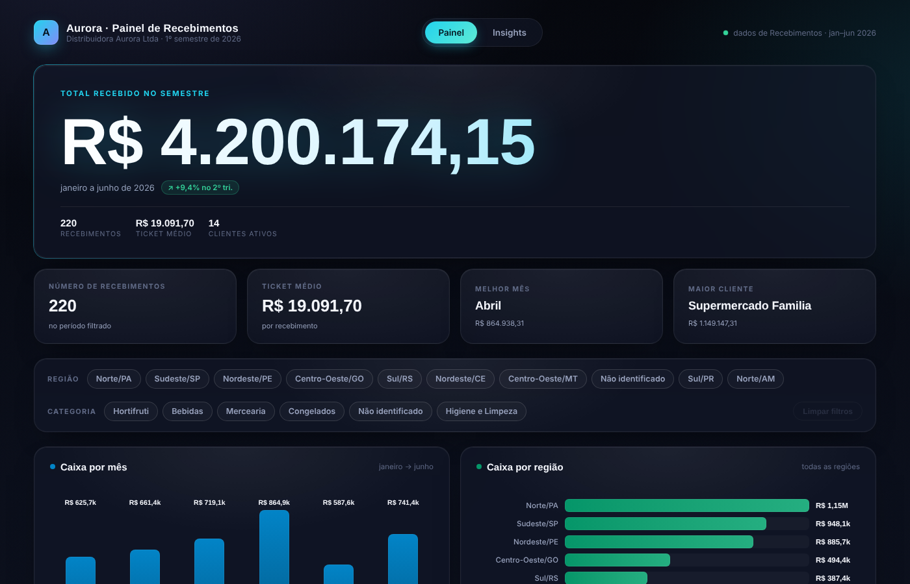
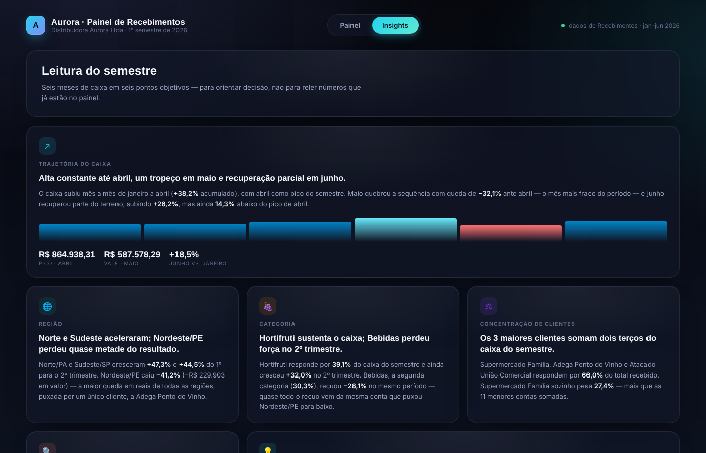

# Painel de Recebimentos — Distribuidora Aurora

🇫🇷 Français · [🇧🇷 Português](#-português)

🔗 **Voir le tableau de bord :** https://brumo97.github.io/painel-recebimentos-aurora/

## 🇫🇷 Français

Cas pratique réalisé à partir de données fictives : les encaissements d'un distributeur alimentaire sur le 1er semestre 2026.

Le point de départ : un tableau de 220 encaissements. L'objectif : comprendre en deux minutes d'où vient l'argent, quel mois a décroché et à quel point l'entreprise dépend de quelques clients.

**Le projet**

- Un classeur Excel : base de données, fichier clients et tableau de bord calculé par formules (`SUMIF`, `SUMPRODUCT`, `INDEX/MATCH`)
- Un tableau de bord web en HTML/CSS/JavaScript, avec des filtres par région et par catégorie, plus un onglet de constats

**Ce que montrent les données**

- 3 clients pèsent 66 % des encaissements : c'est un risque de concentration.
- Avril est le pic du semestre. Mai est le creux, à −32 % par rapport à avril.
- Certains payeurs ne figurent pas dans le fichier clients : il y a un problème de qualité des données à corriger.

---

## 🇧🇷 Português

Estudo de caso feito com dados fictícios: recebimentos de uma distribuidora de alimentos no 1º semestre de 2026.

O ponto de partida: uma planilha com 220 recebimentos. O objetivo: entender em dois minutos de onde vem o dinheiro, qual mês caiu e o quanto a empresa depende de poucos clientes.

**O projeto**

- Uma pasta de trabalho Excel: base de dados, cadastro de clientes e dashboard calculado por fórmulas (`SOMASE`, `SOMARPRODUTO`, `ÍNDICE/CORRESP`)
- Um painel web em HTML/CSS/JavaScript, com filtros por região e categoria e uma aba de insights

**O que os dados mostram**

- 3 clientes concentram 66% dos recebimentos: é um risco de dependência.
- Abril foi o pico do semestre. Maio foi o pior mês, com −32% em relação a abril.
- Há pagadores fora do cadastro de clientes: é um problema de qualidade dos dados a corrigir.

---

`data/` planilha Excel · `docs/` painel web e capturas de tela
